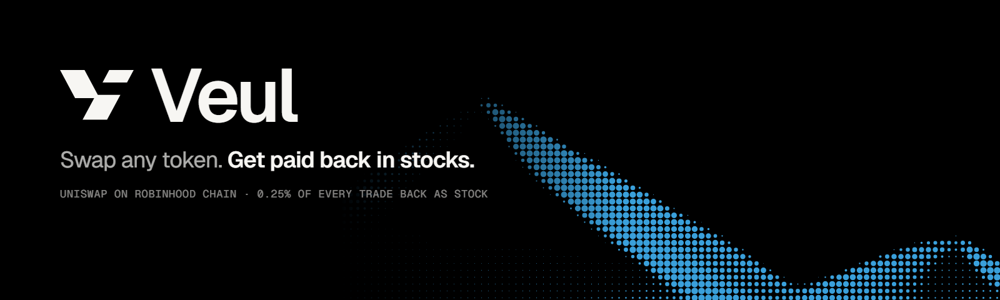

# Veul

Swap any token on Robinhood Chain through Uniswap, and get paid back in stocks. Every swap pays a 0.5% fee;
half of it, 0.25% of the trade, comes back to you every week as the stock token you pick: NVDA, SPY, TSLA
or GOOGL at launch.

Your tokens stay in your own wallet and you sign every swap yourself. Each payback is counted only after the
fee is checked on chain.

**Preview.** Real swaps are open to the team wallet only while the launch checks run. Not available to US persons.

## Open source

| Repository | What |
|---|---|
| [**veul**](https://github.com/veultrade/veul) | Everything that runs Veul: the site and app, swap building on Uniswap's Universal Router, the verified payback ledger, and the chain tools (Apache-2.0) |

issues go to the repository · memecoins can lose all of their value · not financial advice · not affiliated with Robinhood

